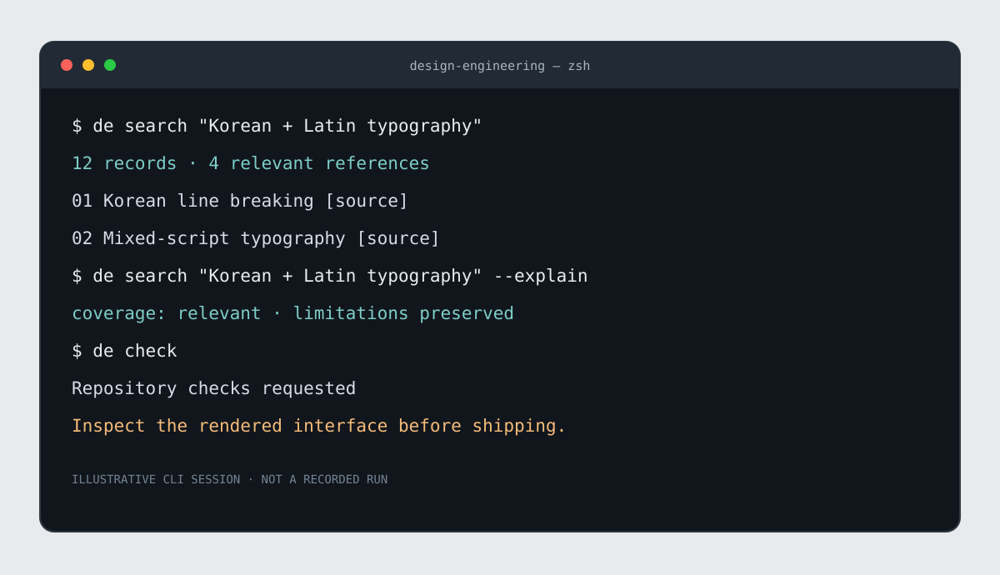
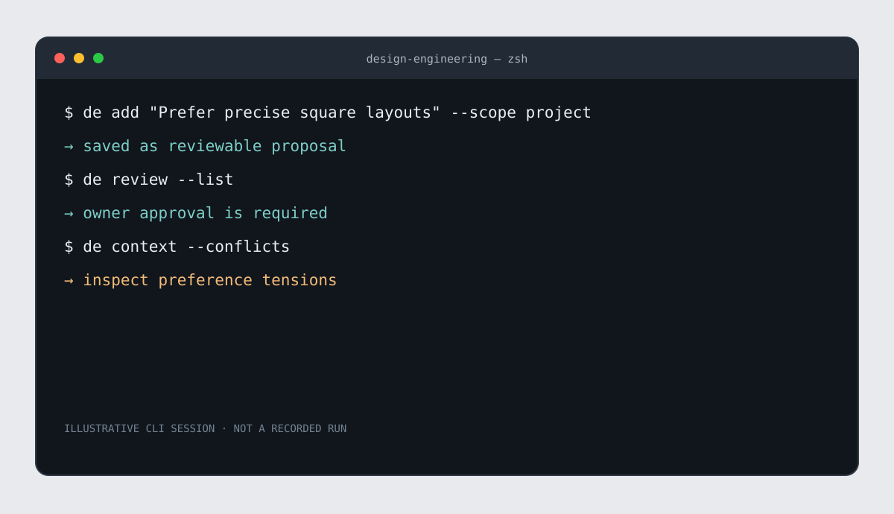
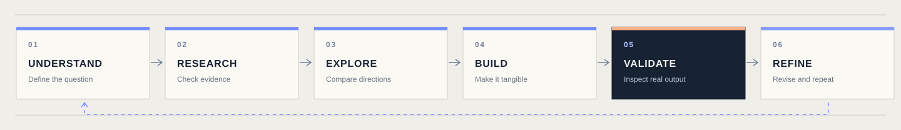

<div align="center">


# Design Engineering

**From evidence to intentional design.**

A research-informed design engineering skill for **Codex and Claude Code**.  
Research with evidence. Build for context. Inspect what actually ships.

<p>
  <a href="README.md"><strong>English</strong></a> ·
  <a href="i18n/README.ko.md">한국어</a>
</p>

<p>
  <a href="#overview">Overview</a> ·
  <a href="#approach">Approach</a> ·
  <a href="#getting-started">Get started</a> ·
  <a href="#documentation">Documentation</a>
</p>

</div>

<p align="center">
  
</p>

<p align="center"><sub>Illustrative CLI screen, not a captured execution or a benchmark result.</sub></p>

## Why Design Engineering

**Good interface design needs judgment, not just consistent components.** Design Engineering is a research-informed skill for coding agents: look up the right evidence, make context-aware design choices, build, inspect and refine. It does not impose one house style.

The approach is **understand → research → explore → build → validate → refine**. Source-backed knowledge and personal or project preferences stay separate, and an automated check is never presented as proof of usability.

## See it in action

<p align="center">
  
</p>

<sub>Animated illustration of documented CLI entry points—not a live recording. Animation support depends on the viewer.</sub>

```bash
de search "How should mixed Korean and Latin headings wrap?"
de search "How should mixed Korean and Latin headings wrap?" --explain
de check
```

The point is not to generate an interface from a generic recipe. The workflow retrieves relevant references and their limitations, then brings the design back to the actual content, viewport and interaction.

## Capabilities

| | What it does |
| --- | --- |
| **Research with provenance** | Finds relevant standards, papers and practitioner methods, while retaining limitations and origins. |
| **Design for context** | Uses content, language, brand, users and constraints to drive hierarchy and composition. |
| **Inspect and refine** | Reviews rendered screens, identifies specific issues and verifies changes. |
| **Keep direction separate** | Handles personal and project preferences as reviewable guidance rather than scientific evidence. |
| **Evaluate carefully** | Supports comparison against baselines without claiming that aesthetic judgments are objective facts. |

### Your project, your direction

<p align="center">
  
</p>

```bash
de add "Prefer precise square layouts and clear typography" --scope project
de review --list
de context --conflicts
```

Project preferences start as drafts. Approval is explicit; research evidence retains independent provenance.

<details>
<summary><strong>The six-stage workflow</strong></summary>

<p align="center">
  
</p>

Start with the actual brief and content, retrieve only relevant knowledge, compare meaningful directions, implement a working interface, inspect it, then refine specific failures.

</details>

## Getting started

Install the **complete repository**, not just `SKILL.md`. The knowledge library and validation tools live alongside it.

###  Claude Code

Run these commands in Claude Code:

```text
/plugin marketplace add ByeonDoHyeon06/design-engineering
/plugin install design-engineering@design-engineering-marketplace
```

###  Codex

Clone the skill into your project's skills directory:

```bash
mkdir -p .agents/skills
git clone https://github.com/ByeonDoHyeon06/design-engineering.git .agents/skills/design-engineering
```

### Unified CLI

From a full, editable checkout:

```bash
python -m pip install -e .
de search "How should mixed Korean and Latin headings wrap?"
de check
```

Manage approved local preferences with `de knowledge list`, `de knowledge edit` (review draft), or `de knowledge archive`. All changes are explicit and history-preserving.

For deeper inspection: `de search "question" --explain --json` explains registered evidence coverage; `de context --conflicts` highlights local preference tensions without automatically resolving them.

For managed plugin installations where editing the plugin is undesirable, use the portable launcher: `python /path/to/design-engineering/scripts/de.py --help`.

<details>
<summary><strong>Add your own design direction</strong></summary>

Preferences and project notes start as **reviewable drafts**, not automatically applied instructions.

```bash
de add "Prefer precise square layouts and clear typography" --scope project
de review --list
de review <proposal-path> --approve --reviewer owner
de context
```

Personal guidance is stored locally and labeled separately from scientific evidence. For scopes, permissions, and more commands, see [Personal knowledge & CLI](docs/personal-knowledge.md).

</details>

## Documentation

| Guide | What you'll find |
| :--- | :--- |
| [Architecture](docs/architecture.md) | System layout, retrieval, and knowledge relationships |
| [CLI & personal knowledge](docs/personal-knowledge.md) | Commands, local preferences, and review workflow |
| [Knowledge management](docs/knowledge-management.md) | Source ingestion, provenance, duplication, and lifecycle |
| [Evidence policy](knowledge/VERIFICATION-POLICY.md) | What a source or claim does—and does not—establish |
| [Typography & writing](docs/typography-writing.md) | Korean text layout, microcopy, and content structure |
| [Visual critique](docs/visual-critique.md) · [UX validation](docs/ux-validation.md) | Rendered-screen and task-based review |
| [Design execution](docs/design-execution.md) | Content-first composition, asset provenance, visual revision loop |
| [Design evaluation](docs/design-evaluation.md) | How to run transparent, blinded skill vs baseline studies |
| [Contributing](CONTRIBUTING.md) | Contribution process and required checks |

<details>
<summary><strong>Repository map</strong></summary>

```text
SKILL.md                Canonical instructions for both agents
design_engineering/      Unified CLI and locally scoped knowledge
knowledge/               Cards, sources, claims, and governance
methods/                 Practitioner methods
scripts/                 Retrieval and verification tools
templates/               Review and workflow templates
assets/                  Original README artwork and project mark
docs/ · i18n/            Guides and translations
tests/ · benchmarks/     Automated checks and retrieval regressions
.claude-plugin/ · agents/ Integration metadata
```

</details>

## Contributing

Contributions to design reasoning, research quality, accessibility, validation, and documentation are welcome. Check existing records before adding more knowledge, and distinguish source-backed findings from interpretation. See [CONTRIBUTING.md](CONTRIBUTING.md).

<sub>Research retrieval is not automatic scientific certification. Screenshots and scripted browser checks do not replace usability studies. The goal is better-informed, testable design—not a universal aesthetic score.</sub>
