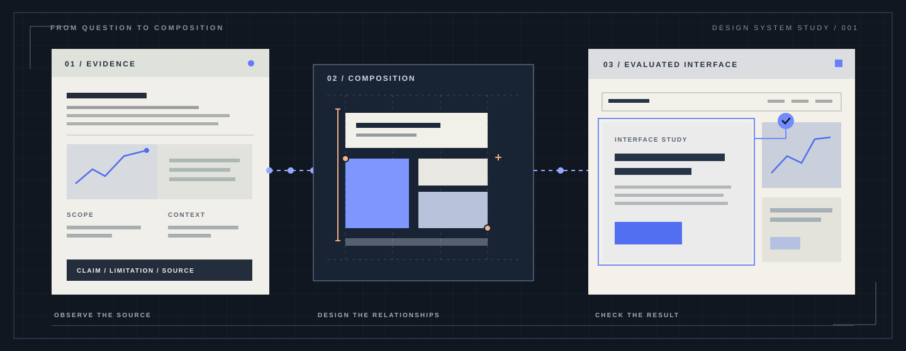
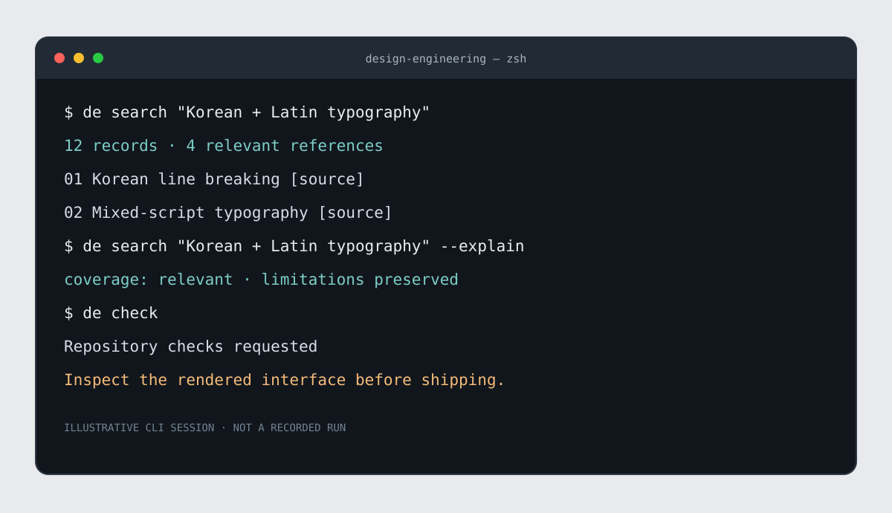
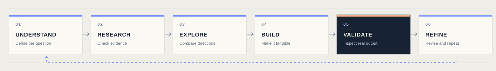
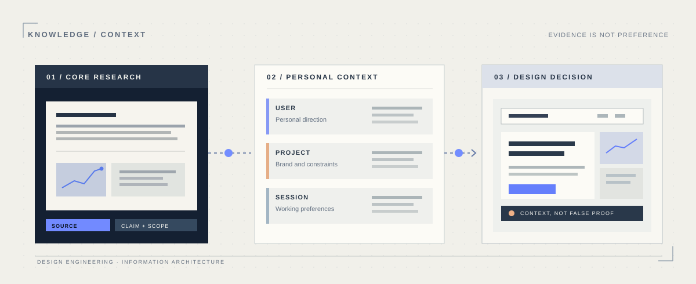
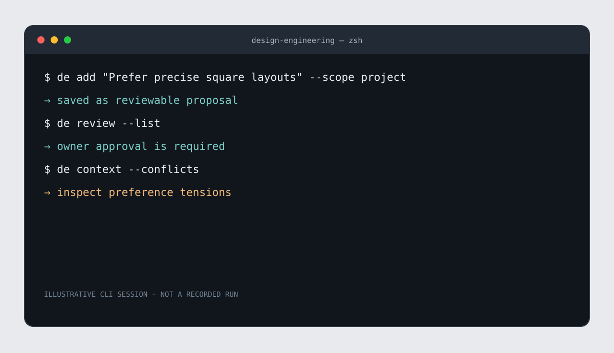
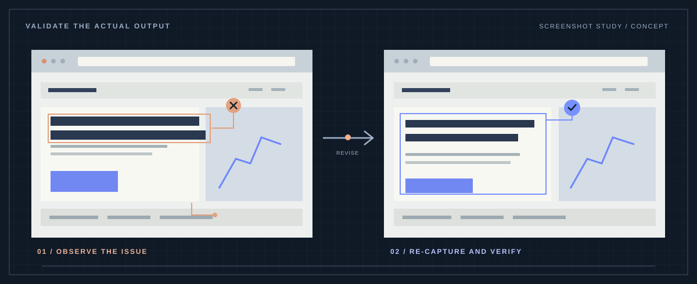

<div align="center">


# Design Engineering

**근거에서 시작해 의도 있는 디자인으로.**

**Codex와 Claude Code**를 위한 연구 기반 디자인 엔지니어링 스킬.  
관련 지식을 찾고, 실제 맥락에 맞게 설계하고, 결과를 검증합니다.

<p>
  <a href="../README.md">English</a> ·
  <a href="README.ko.md"><strong>한국어</strong></a>
</p>

<p>
  <a href="#프로젝트-소개">소개</a> ·
  <a href="#터미널로-살펴보는-사용-흐름">CLI 예시</a> ·
  <a href="#작업-방식">작업 방식</a> ·
  <a href="#시작하기">시작하기</a> ·
  <a href="#문서">문서</a>
</p>

</div>

<p align="center">
  <picture>
    <source media="(max-width: 640px)" srcset="../assets/hero-system-mobile.svg" />
    
  </picture>
</p>

## 프로젝트 소개

**Design Engineering**은 AI 코딩 에이전트가 디자인을 더 신중하게 판단하도록 돕습니다. 출처를 확인할 수 있는 연구, 콘텐츠와 레이아웃 설계, 실제 구현, 렌더링된 결과물의 검토를 하나의 워크플로로 연결합니다.

특정 디자인 스타일이나 컴포넌트 라이브러리, 정해진 페이지 구조를 강요하지 않습니다. *무엇을 만들 것인가*뿐 아니라 *왜 이 방향이 적합하며 실제로 무엇을 확인했는가*를 함께 다룹니다.

<table>
  <tr>
    <td width="50%" valign="top">
      <strong>◈ &nbsp; 연구 기반 판단</strong>
      <p>논문·표준·실무 방법론에서 필요한 지식을 검색하고, 출처의 근거 범위와 한계를 구분합니다.</p>
    </td>
    <td width="50%" valign="top">
      <strong>◇ &nbsp; 맥락 중심 설계</strong>
      <p>획일적인 레이아웃 대신 실제 콘텐츠, 브랜드, 사용자 목적과 제약을 바탕으로 디자인합니다.</p>
    </td>
  </tr>
  <tr>
    <td valign="top">
      <strong>↗ &nbsp; 검토와 개선</strong>
      <p>브라우저 화면과 사용자 과제를 검사하고, 문제를 수정한 뒤 결과를 다시 확인합니다.</p>
    </td>
    <td valign="top">
      <strong>◎ &nbsp; 개인화 지식</strong>
      <p>사람과 AI가 디자인 취향과 관찰을 추가하되, 검증된 연구 자료와 혼동되지 않도록 관리합니다.</p>
    </td>
  </tr>
</table>

## 터미널로 살펴보는 사용 흐름

연구 검색과 검증 과정을 명령줄에서도 사용할 수 있습니다.



<sub>실제 실행 화면이나 벤치마크 결과가 아닌 설명용 예시입니다.</sub>

### 질문부터 점검까지



```bash
de search "How should mixed Korean and Latin headings wrap?"
de search "How should mixed Korean and Latin headings wrap?" --explain
de check
```

검색 결과의 근거와 한계를 확인하고 저장소 점검을 실행할 수 있습니다. 자동 점검만으로 실제 화면 품질이 검증되는 것은 아닙니다.

## 작업 방식

<p align="center">
  <picture>
    <source media="(max-width: 640px)" srcset="../assets/process-loop-mobile.svg" />
    
  </picture>
</p>

과제를 정의하고 실제 콘텐츠를 확인한 다음, 필요한 근거만 찾아 의미 있는 설계 방향을 비교합니다. 동작하는 결과물을 만들고 실제 화면을 살펴 수정합니다. 자동 테스트 통과가 반드시 좋은 사용자 경험을 의미하는 것은 아닙니다.

### 지식은 쌓아두는 것이 아니라 맥락에 맞게 활용합니다

#### 공통 연구와 개인 선호를 명확하게 구분

<p align="center">
  <picture>
    <source media="(max-width: 640px)" srcset="../assets/knowledge-context-mobile.svg" />
    
  </picture>
</p>

출처가 확인된 연구와 사용자·프로젝트·세션 취향을 별도로 관리합니다. AI가 작성한 내용도 검토 및 승인을 거치기 전에는 공통 근거로 등록되지 않습니다.

##### 프로젝트 방향 관리 예시



```bash
de add "Prefer precise square layouts and clear typography" --scope project
de review --list
de context --conflicts
```

<sub>실제 실행 로그가 아닌 설명용 예시입니다. 개인·프로젝트 선호와 검증된 연구 근거는 구분합니다.</sub>

#### 실제 결과를 확인하고 개선

<p align="center">
  <picture>
    <source media="(max-width: 640px)" srcset="../assets/validation-study-mobile.svg" />
    
  </picture>
</p>

정보 위계, 타이포그래피, 레이아웃, 상호작용 상태를 실제 화면에서 확인합니다. 이미지는 **검토 방법을 설명하는 개념도**이며 실제 제품의 테스트 결과를 의미하지 않습니다.

## 시작하기

`SKILL.md` 하나가 아니라 **저장소 전체**를 설치해야 합니다. Knowledge 자료와 검증 도구가 함께 필요하기 때문입니다.

###  Claude Code

Claude Code 안에서 다음을 실행합니다.

```text
/plugin marketplace add ByeonDoHyeon06/design-engineering
/plugin install design-engineering@design-engineering-marketplace
```

###  Codex

프로젝트의 스킬 디렉터리에 전체 저장소를 복제합니다.

```bash
mkdir -p .agents/skills
git clone https://github.com/ByeonDoHyeon06/design-engineering.git .agents/skills/design-engineering
```

### 통합 CLI

전체 저장소의 편집 가능한 체크아웃에서:

```bash
python -m pip install -e .
de search "한글과 영문이 섞인 제목은 어떻게 줄바꿈할까?"
de check
```

저장한 취향은 `de knowledge list`로 확인하고, `de knowledge edit`으로 수정 초안을 만들거나 `de knowledge archive`로 이력과 함께 보관할 수 있어.

추가 진단을 위해 `de search "질문" --explain --json`은 검색 근거를, `de context --conflicts`는 잠재적인 개인 선호 충돌 후보를 보여줘. 어느 쪽도 자동으로 결론을 확정하지 않아.

플러그인 폴더를 변경하기 어렵다면 설치 없이 `python /path/to/design-engineering/scripts/de.py --help`를 실행할 수 있습니다.

<details>
<summary><strong>나만의 디자인 방향성 등록하기</strong></summary>

개인·프로젝트 선호는 즉시 적용되는 대신 **검토용 초안**으로 생성됩니다.

```bash
de add "정교한 사각형과 명확한 타이포그래피를 선호해" --scope project
de review --list
de review <proposal-path> --approve --reviewer owner
de context
```

개인 선호는 로컬에 저장되며 학술 연구와 명확히 구분됩니다. 저장 범위, 권한, 세부 명령은 [Personal Knowledge & CLI](../docs/personal-knowledge.md) 문서를 참고하세요.

</details>

## 문서

| 문서 | 주요 내용 |
| :--- | :--- |
| [Architecture](../docs/architecture.md) | 시스템 구성, 검색, 지식 관계 모델 |
| [CLI & personal knowledge](../docs/personal-knowledge.md) | 통합 CLI, 개인 지식, 승인 절차 |
| [Knowledge management](../docs/knowledge-management.md) | 자료 등록, 출처 추적, 중복 및 수명주기 |
| [Evidence policy](../knowledge/VERIFICATION-POLICY.md) | 출처와 주장이 입증하는 범위 및 한계 |
| [Typography & writing](../docs/typography-writing.md) | 한글 조판, UX 문장, 콘텐츠 구조 |
| [Visual critique](../docs/visual-critique.md) · [UX validation](../docs/ux-validation.md) | 실제 화면·사용자 과제 검토 |
| [Design execution](../docs/design-execution.md) | 실제 콘텐츠와 시각적 에셋 방향, 수정 근거 관리 |
| [Design evaluation](../docs/design-evaluation.md) | 스킬 적용 전후 블라인드 비교 평가 방법 |
| [Contributing](../CONTRIBUTING.md) | 기여 방법과 필수 검증 |

<details>
<summary><strong>저장소 구성</strong></summary>

```text
SKILL.md                모든 에이전트가 공유하는 스킬 지침
design_engineering/      통합 CLI 및 개인 Knowledge
knowledge/               연구 카드, 출처, 주장, 관리 정보
methods/                 실무 디자인 방법론
scripts/                 검색·검증 내부 도구
templates/               작업 및 등록 템플릿
assets/                  README 일러스트와 프로젝트 아이콘
docs/ · i18n/            기술 문서와 번역
tests/ · benchmarks/     자동 테스트 및 검색 회귀
.claude-plugin/ · agents/ 에이전트별 연동 설정
```

</details>

## 기여하기

설계 방법론, 연구 지식, 접근성, 검증 도구, 문서화에 대한 기여를 환영합니다. 새로운 Knowledge를 추가하기 전에 기존 자료와 중복되지 않는지 살펴보고, 출처를 확인한 사실과 해석을 구분해 주세요. 상세 기준은 [CONTRIBUTING.md](../CONTRIBUTING.md)에 있습니다.

<sub>Knowledge 검색은 논문을 자동 인증하지 않습니다. 스크린샷과 자동화된 브라우저 검사는 실제 사용자 연구를 대체하지 않습니다. 이 프로젝트는 정답 스타일을 제공하기보다, 더 잘 설명할 수 있고 검증 가능한 디자인을 지향합니다.</sub>
